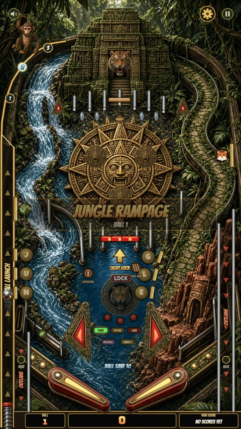

# Jungle Rampage Pinball

**Play free in your browser:** [Try Jungle Rampage Pinball](https://micre13b.com/projects/jungle-rampage-pinball/index.html)

A jungle-temple pinball table with ramps, tiger lock, multiball, and a Temple of Gold wizard mode. No download required — just open the link above or double-click `index.html`.

## About

This game was generated through multiple iterations and refinements with **Grok**. The graphics (including the playfield video and art) were created with **Grok Imagine**.

## Features

- **Animated video background** — the playfield is a full-motion video (WebM/MP4) that loops behind the table for a rich, living jungle-temple atmosphere
- **Smart loading progress bar** — tracks the download of large video and image resources so you can see exactly how much is left before the table launches
- Full pinball physics with responsive flippers, ramps, and slingshots
- Skill shot on the launch lane
- Spell **JUNGLE** to start expedition modes
- Tiger lock and 4-ball multiball with jackpots
- Temple of Gold wizard mode
- Runs entirely in the browser (or from a local `index.html`) with no install or server required

## How to play locally

1. Clone or download this repository
2. Open `index.html` in a modern browser

No build step or server is required. The loading bar will show progress while the video assets load.

## Credits

- Code and design refined with Grok
- Graphics and video generated with Grok Imagine
- Font: Bangers (SIL Open Font License)
